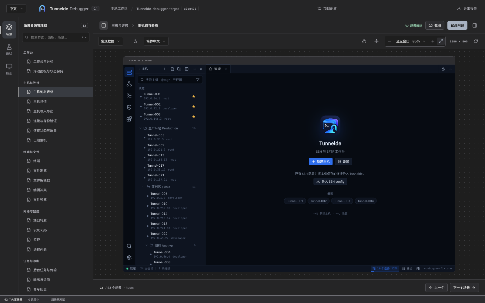

# TunneldeDebugger

[简体中文](README.md)

[](https://github.com/TunneldeDev/TunneldeDebugger/actions/workflows/desktop.yml)
[](https://github.com/TunneldeDev/TunneldeDebugger/releases/latest)
[](LICENSE)
[](package.json)
[](package.json)

[Guide](docs/en-us/guide.md) · [Coverage and validation](docs/en-us/validation.md) · [Contributing](CONTRIBUTING.md) · [Security](SECURITY.md) · [Changelog](CHANGELOG.md)

A local development and acceptance workbench for Tunnelde. The React UI runs in a browser or a Tauri desktop window, sharing a Node service for production-component scenarios, test orchestration, isolated native instances and traceable acceptance records.



## Run from source

Clone Tunnelde into the neighboring `../Tunnelde` directory first, or use an existing checkout.

Requires Node.js 24+, pnpm 10+ and Git. Native mode also requires Rust and the platform's Tauri development dependencies; macOS requires Xcode Command Line Tools. Install Chromium before browser tests.

```sh
pnpm install --frozen-lockfile
pnpm setup:target ../Tunnelde ../Tunnelde-debugger-target
pnpm exec playwright install chromium
pnpm dev
# In another terminal; shares the existing service
pnpm desktop
```

Open <http://127.0.0.1:4760>. `setup:target` creates a separate worktree next to the main repository at the remote dev revision pinned in `integration/base.json`, which already includes the development adapter and settings group scrolling fix, without changing files in the original checkout. Existing targets are reused without updating or overwriting their changes; choose a new target directory to upgrade. `integration/tunnelde.patch` is retained only as a historical patch for the early baseline and must not be applied to the current baseline.

Use `pnpm dev --target /absolute/checkout --data /absolute/local-data --port 4760` to override paths. Environment variables are `TUNNELDE_TARGET` and `TUNNELDE_DEBUGGER_DATA`. Four consecutive ports serve the workbench, iframe renderer, native frontend and HMR. The desktop wrapper currently uses the default port.

## Use

- **Scenarios**: 43 built-in surface entries, including 14 settings sections. Applicable presets, deterministic seeds, theme, language and viewport are independent parameters. The iframe uses production components with isolated styles, focus and in-memory storage.
- **Tests**: discover Vitest, Rust, Node, Playwright and native tasks; expand files/cases, run selections or all discovered tests, inspect output, duration, failures and cancellation. Node dynamic cases join the tree after execution. Initial Rust discovery compiles test binaries.
- **Desktop instances**: start an isolated Tunnelde in UI simulation or real-service mode. Real-service checks cover hosts, settings, file editing and controlled SSH/SFTP, including moving production panels into native windows and back.
- **Acceptance**: save issue titles, descriptions, steps, expected results and conclusions; capture the current scene or upload, paste and annotate images. Drafts survive navigation and reload. Search, edit, move history to Trash or restore it and export saved records as JSON. Automated checks and manual conclusions remain separate.

Native mock switching recreates the document. Real-service resets create a new profile. Manual native operations report an ownership error while a queued native test owns the instance.

The preview defaults to **Fit to window**. Use **− / percentage / +** above it to zoom, or choose **100%** for actual pixels. Toggle the sidebars from the scene heading; the desktop window fits the current monitor’s work area on startup.

## Verify

```sh
pnpm check                 # Types, protocol/scheduler/process tests, workbench build
pnpm test:browser          # Production surfaces and key interactions
pnpm acceptance:runners    # Real discovery/exact selection for four runners; service required
pnpm acceptance:native     # 43 native mock + 5 real-service tasks; macOS required
# Rerun a single task
pnpm acceptance:native 'native:native-service#files'
```

Read the [guide and architecture](docs/en-us/guide.md), [coverage and validation notes](docs/en-us/validation.md) and [upstream adapter documentation](https://github.com/TunneldeDev/Tunnelde/blob/dev/docs/en-us/development/debugger.md). Native tasks require an interactive desktop session. Capture failures retain their reason and never create successful screenshot evidence.

Local data lives in the ignored `.tunnelde-debugger/` directory: runs, acceptance records, instance profiles, logs and artifacts. Stop instances and back up reports before deleting it. Unfinished tasks become interrupted after a service restart.

`v0.1.0` is a source-only release with no installers attached. Windows/Linux native source adaptation is retained but has not been validated on those systems. Licensed GPL-3.0-only.
