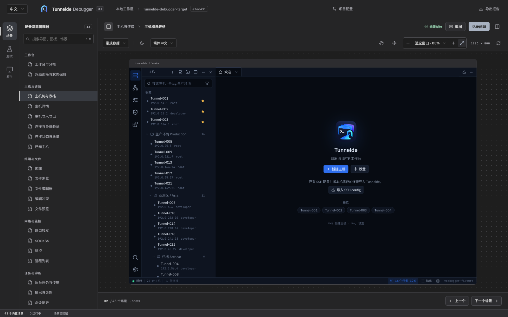

# TunneldeDebugger

[English](README.en-us.md)

[](https://github.com/TunneldeDev/TunneldeDebugger/actions/workflows/desktop.yml)
[](https://github.com/TunneldeDev/TunneldeDebugger/actions/workflows/codeql.yml)
[](https://github.com/TunneldeDev/TunneldeDebugger/releases/latest)
[](LICENSE)
[](CITATION.cff)
[](package.json)
[](package.json)

[使用指南](docs/zh-cn/guide.md) · [覆盖与验收](docs/zh-cn/validation.md) · [支持](SUPPORT.md) · [参与贡献](CONTRIBUTING.md) · [安全策略](SECURITY.md) · [引用](CITATION.cff) · [更新记录](CHANGELOG.md)

Tunnelde 的本地开发与验收工作台。React 工作台可在浏览器或 Tauri 桌面运行，共用 Node 服务，支持生产组件场景、统一测试侧栏、隔离原生实例及可追溯的验收记录。



## 从源码启动

先将 Tunnelde 克隆到相邻的 `../Tunnelde` 目录（已有仓库可直接使用）。

要求 Node.js 24+、pnpm 10+、Git；原生模式还需 Rust 和 Tauri 对应平台的开发依赖。macOS 需 Xcode Command Line Tools。首次浏览器测试需安装 Chromium。

```sh
pnpm install --frozen-lockfile
pnpm setup:target ../Tunnelde ../Tunnelde-debugger-target
pnpm exec playwright install chromium
pnpm dev
# 另一个终端；复用同一个服务
pnpm desktop
```

浏览器打开 <http://127.0.0.1:4760>。`setup:target` 在主仓库旁创建独立 worktree，使用 `integration/base.json` 固定的远端 dev 版本，其中已包含开发适配器和设置分组滚动修复，不修改原工作区的文件。已有目标目录会复用，不会自动更新或覆盖其修改；升级时可指定一个新的目标目录。`integration/tunnelde.patch` 仅保留为早期基线的历史补丁，当前基线无需应用。

可用 `pnpm dev --target /absolute/checkout --data /absolute/local-data --port 4760` 指定路径。环境变量为 `TUNNELDE_TARGET`、`TUNNELDE_DEBUGGER_DATA`。连续四个端口分别用于工作台、iframe、原生前端和 HMR。桌面包装目前使用默认端口。

## 使用

- **场景**：43 个内置界面条目，包括 14 类设置；支持适用的数据预设、固定种子、主题、语言和尺寸。iframe 加载 Tunnelde 的生产组件，样式、焦点和内存存储独立。
- **测试**：分别发现 Vitest、Rust、Node、Playwright 和原生任务，展开文件或用例，运行选择项或已发现全部，查看输出、耗时、失败与取消结果。Node 动态子用例在运行后加入树中。首次 Rust 发现需要编译测试程序。
- **桌面实例**：选择“界面模拟”或“真实服务”，启动隔离 Tunnelde。真实服务可检查主机、设置、文件编辑以及受控 SSH/SFTP，并将生产面板移到原生小窗再返回。
- **验收**：记录问题标题、描述、复现步骤、预期结果和结论；截取当前界面或上传／粘贴／标注图片。草稿自动保留，历史记录支持搜索、编辑、删除和回收站恢复，保存后可导出 JSON 报告。

原生模拟切换会重建文档，真实服务场景重启使用新配置目录。测试队列占用原生实例时，手工原生操作会收到明确的占用提示。

预览默认“适应窗口”，上方可用 **−／百分比／＋** 缩放，选择 **100%** 查看原始尺寸。标题栏两端按钮可收起侧栏；桌面窗口启动时自动适配当前屏幕的可用区域。

## 验证

```sh
pnpm check                 # 类型、协议/调度/进程测试、工作台构建
pnpm test:browser          # 生产界面及关键交互
pnpm acceptance:runners    # 四类运行器真实发现与精确选择，需要服务运行
pnpm acceptance:native     # 43 个原生模拟 + 5 个真实服务任务，需要 macOS
# 单独重跑
pnpm acceptance:native 'native:native-service#files'
```

参阅[操作与架构](docs/zh-cn/guide.md)、[覆盖与验收说明](docs/zh-cn/validation.md)及[主仓库适配说明](https://github.com/TunneldeDev/Tunnelde/blob/dev/docs/zh-cn/development/debugger.md)。原生窗口检查需要可交互的桌面会话；截图失败会保留原因，不生成成功截图证据。

运行数据位于 `.tunnelde-debugger/`，包含运行记录、验收记录、实例配置、日志和产物；已加入 Git 忽略。关闭实例并备份所需报告后，可删除该目录。未完成任务在服务重启后标为“已中断”。

## 支持

先查阅 [支持说明](SUPPORT.md) 中的文档索引。使用问题请到 [Discussions](https://github.com/TunneldeDev/TunneldeDebugger/discussions)，缺陷和功能请求使用 Issue 表单，安全漏洞按 [安全策略](SECURITY.md) 私密报告。提交日志和截图前请移除凭据、私钥与真实主机信息。

## 引用

如果 TunneldeDebugger 对你的文档、研究或发布工作有帮助，可按仓库中的 [CITATION.cff](CITATION.cff) 引用：

> TunneldeDev. (2026). *TunneldeDebugger* (Version 0.1.1) [Computer software]. https://github.com/TunneldeDev/TunneldeDebugger

GitHub 会根据该文件在仓库页面提供 “Cite this repository” 入口。

`v0.1.1` 是仅提供源码的 Release，不附带安装包。Windows/Linux 原生功能保留源码适配，尚未实际验收。许可证 GPL-3.0-only。
